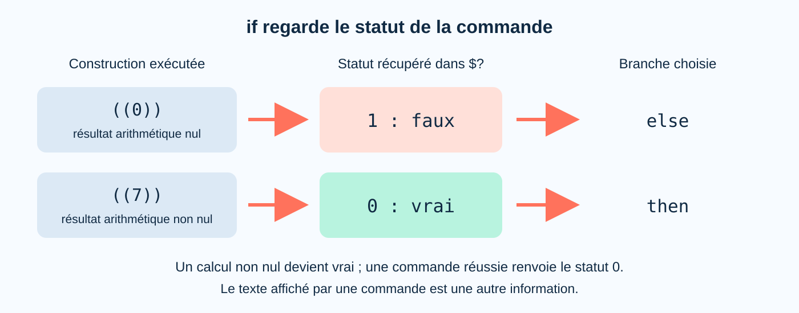

# TP 3 — Donner des décisions aux outils d'Aurore

## Mission 5 — Construire une boîte à outils Bash

Les outils d'Aurore savent enchaîner des commandes. Apprends-leur à recevoir une demande, choisir une action, répéter un calcul et lire des données.

Commence par un script guidé, puis assemble les commandes dans des programmes de plus en plus complexes.

Le TP se déroule sur plusieurs séances.

- **Entraînement** dans `preparation`.
- **Huit outils à rendre** dans `scripts`.

!!! warning "Périmètre de travail"
    Crée tes fichiers dans `~/base-exploration/tp3/atelier-decisions`. Change les droits des fichiers de l'atelier uniquement. Travaille sans `sudo` et garde la configuration de ton shell intacte.

## Installer l'atelier

- [Archive de l'atelier TP3](../assets/tp3-atelier-decisions.zip)
- [Carnet de progression facultatif](../assets/tp3-modele-notes.txt)

**Dans le terminal**, crée le dossier de travail, télécharge l'archive et ouvre l'atelier.

```bash
mkdir -p ~/base-exploration/tp3
cd ~/base-exploration/tp3
wget https://valt78.github.io/cours-linux/assets/tp3-atelier-decisions.zip
unzip tp3-atelier-decisions.zip
cd atelier-decisions
ls
cat 00-LIRE-MOI.txt
```

**Pour reprendre**, reviens dans `atelier-decisions` sans extraire à nouveau l'archive. Ce dossier est ton point de départ, sauf indication contraire.

---

## Niveau 0 — Créer `repere.sh`

Un script est un fichier texte. Bash lit ses commandes et les exécute dans l'ordre.

### 0.1 Essayer les commandes dans le terminal

**Dans le terminal**, essaie les commandes une par une depuis l'atelier.

```bash
echo "Connexion au relais"
pwd
whoami
```

`echo` affiche ton message. `pwd` donne le dossier courant et `whoami` le nom de l'utilisateur. Leur réponse dépend du lancement.

### 0.2 Conserver deux commandes dans un fichier

Ouvre le fichier dans `nano`.

```bash
nano preparation/repere.sh
```

**Dans l'éditeur**, recopie le script.

```bash
#!/usr/bin/env bash
echo "Atelier Aurore"
pwd
```

1. `#!/usr/bin/env bash` est le **shebang**. Il choisit Bash au lancement direct et n'affiche rien.
2. `echo` affiche le titre.
3. `pwd` affiche le dossier de travail.

Les autres lignes qui commencent par `#` sont des commentaires. Saisis les commandes sans l'invite `$`.

**Ctrl+S** enregistre. Confirme le nom du script si demandé. **Ctrl+X** te ramène au terminal.

### 0.3 Relire le fichier, puis exécuter le script

**Relis** le fichier.

```bash
cat preparation/repere.sh
```

`cat` montre le code. **Lance** maintenant le script avec Bash.

```bash
bash preparation/repere.sh
```

Bash exécute les commandes de haut en bas. Voici un exemple de résultat.

```text
Atelier Aurore
/home/valt/base-exploration/tp3/atelier-decisions
```

Le chemin affiché est celui de ton atelier. Tu vois le résultat des commandes que `cat` t'a montrées.

### 0.4 Compléter ton premier programme

Rouvre `preparation/repere.sh` et ajoute la commande qui affiche l'utilisateur. Enregistre, quitte et relance.

Vérifie les trois lignes dans l'ordre.

1. `Atelier Aurore`
2. Le dossier courant fourni par `pwd`
3. L'utilisateur courant fourni par la commande ajoutée

Essaie depuis `donnees`, puis reviens à l'atelier.

```bash
cd donnees
bash ../preparation/repere.sh
cd ..
```

La deuxième ligne doit désigner `donnees`. Le fichier reste dans `preparation`. Bash exécute ses commandes depuis le **dossier de lancement**.

### 0.5 Vérifier le programme que tu viens de créer

Une fois les trois lignes obtenues, lance le vérificateur fourni.

```bash
bash verifier.sh repere
```

Il teste `repere` depuis deux dossiers. Si l'attendu et l'obtenu diffèrent, corrige le fichier puis relance la même commande.

Pour les autres scripts, remplace `repere` par leur nom, avec ou sans `.sh`. Le vérificateur contrôle syntaxe, sorties et statuts, et interrompt un essai trop long. Respecte aussi la méthode demandée dans l'exercice.

`bash verifier.sh` liste les programmes. `bash verifier.sh tout` les vérifie tous. Le vérificateur utilise les outils du Linux GNU du cours.

### 0.6 Deux commandes utiles pour la suite

**Contrôle la syntaxe** avec `bash -n`.

```bash
bash -n preparation/repere.sh
```

Si Bash reste silencieux, la syntaxe est correcte. Lance le script pour vérifier son comportement.

**Lance directement** le script après avoir donné le droit d'exécution.

```bash
chmod u+x preparation/repere.sh
./preparation/repere.sh
```

`bash fichier` lit le script. `./` indique son chemin et le lancement direct utilise le shebang. L'extension `.sh` sert de repère. `chmod` règle les droits.

---

## Niveau 1 — Garder et recevoir des valeurs

### Variables et guillemets

```bash
zone='Aurore Nord'
echo "Zone : ${zone}"
echo "${zone}_secours"
unset zone
echo "Valeur restante : <${zone}>"
```

`nom=valeur` affecte du texte sans déclaration préalable. Colle le `=`. Le nom contient lettres, chiffres et `_`, et commence par une lettre ou `_`.

`$zone` lit la valeur. Les accolades de `${zone}` délimitent le nom. `unset` supprime la variable. Ici, une variable absente donne un texte vide.

Les guillemets gardent un nom avec espaces dans un seul argument.

```bash
document='donnees/nom avec espaces.txt'
cat ${document}
cat "${document}"
```

Le premier appel découpe le nom. Une affectation simple garde la valeur entière, comme `copie="${document}"`.

`printf` affiche une valeur qui ressemble à une option.

```bash
valeur='-n'
printf '%s\n' "${valeur}"
```

Dans `'%s\n'`, `%s` insère le texte et `\n` termine la ligne. Le format se répète pour chaque valeur. Utilise `echo` pour les messages simples.

### Les paramètres d'appel

| Écriture | Valeur dans le script |
|---|---|
| `$0` | nom ou chemin utilisé pour le lancer |
| `$1`, `$2`, `$3`… | arguments reçus ; un argument manquant est vide ici |
| `${10}` | dixième argument, sans confusion avec `$1` suivi de `0` |
| `$#` | nombre d'arguments, sans compter `$0` |
| `"$*"` | tous les arguments regroupés en un texte, séparés habituellement par des espaces |
| `"$@"` | tous les arguments en conservant chacun séparément |

### À toi de construire `parametres.sh`

Dans `preparation/parametres.sh`, affiche `$#`, `$0`, `$1`, `$2` et `$3`, chacun sur sa ligne, sans étiquette. Conserve les lignes vides.

Essaie de zéro à cinq arguments. Compare `Hello World '!'` et `'Hello World !'`. Observe `$0` avec un chemin absolu. Lance `bash verifier.sh parametres`.

### Transmettre une variable à un enfant

```bash
secteur_aurore='Aurore Nord'
bash -c 'echo "Enfant : <${secteur_aurore}>"'
export secteur_aurore
bash -c 'echo "Enfant : <${secteur_aurore}>"'
export -n secteur_aurore
```

`bash -c` exécute le texte donné dans un Bash enfant. `export` transmet la variable aux futurs enfants. `export -n` garde la valeur locale et arrête sa transmission. `export secteur_aurore='Aurore Nord'` affecte et exporte en une ligne.

Une variable vit jusqu'à `unset` ou à la fin du shell. Les changements d'un enfant restent dans l'enfant.

Les variables d'environnement usuelles portent des majuscules. `USER` désigne le compte, `HOME` son dossier, `PWD` le dossier courant et `SHELL` généralement le shell de connexion déclaré. Réserve ces noms à leur usage système.

**Crée `preparation/enfant.sh`.** Affiche la valeur de `secteur_aurore` entre chevrons, ou `<>` si elle manque. Affecte-lui ensuite `modifie`. Essaie avant et après `export` et vérifie la valeur du parent. Termine avec `unset secteur_aurore` et `bash verifier.sh enfant`.

### `PATH` : pourquoi `ls` fonctionne-t-il partout ?

`PATH` liste les dossiers de recherche séparés par `:`, comme `/usr/local/bin:/usr/bin:/bin`. Pour `ls`, Bash y cherche l'exécutable dans l'ordre. `./preparation/repere.sh` désigne directement le fichier.

```bash
echo "$PATH" | tr ':' '\n'
type bash
type cd
repere.sh
PATH="$PWD/preparation:$PATH" repere.sh
```

`tr` affiche un dossier par ligne. `type` indique si le nom désigne une commande interne comme `cd`, un fichier, un alias ou une fonction.

`repere.sh` seul est normalement introuvable. La dernière ligne ajoute `preparation` par son chemin absolu pour cet appel et conserve la liste initiale. Changer de dossier laisse `PATH` intact.

Le shebang `#!/usr/bin/env bash` repose sur cette recherche : `/usr/bin/env` retrouve Bash dans `PATH`.

---

## Niveau 2 — Choisir une action et signaler le résultat

### Une commande renvoie aussi un statut

```bash
cat donnees/absent.txt
code=$?
echo "Statut conserve : ${code}"
```

`$?` contient le dernier statut. `0` signifie succès. Un statut non nul signale une erreur ou une condition fausse. Sauvegarde-le aussitôt, car le prochain `echo` le remplace.

Observe les statuts de `cat /etc/passwd`, `cat /`, `ls` sur un nom absent, puis `touch` et `mkdir` dans `essais`.

`exit 0` termine avec succès et `exit 1` signale une erreur. Sans `exit`, le script transmet le dernier statut. Bash utilise les valeurs de `0` à `255`.

Pour un programme externe, l'enfant charge le programme via un mécanisme comme `execve`, que les fonctions `exec*` peuvent préparer. Le parent attend la fin via un mécanisme comme `wait` et récupère le statut.

### `if` et `test`

```bash
if grep -q 'OK' donnees/message.txt; then
    echo "Relais disponible"
else
    echo "Pas de confirmation"
fi
```

`if` choisit selon le statut avant `then`. `grep -q` répond par son statut, sans sortie. Le séparateur `;` permet de placer `then` sur la même ligne. Ajoute un cas avec `elif autre_commande; then`, un défaut éventuel avec `else`, et ferme avec `fi`.

`test expression` et `[ expression ]` sont équivalents. Espace les crochets et l'expression.

| Besoin | Expression de test |
|---|---|
| textes égaux / différents | `[ "${a}" = "${b}" ]` / `[ "${a}" != "${b}" ]` |
| texte vide / non vide | `[ -z "${a}" ]` / `[ -n "${a}" ]` |
| entiers égaux / différents | `-eq` / `-ne` entre les deux valeurs |
| comparer des entiers | `-lt`, `-le`, `-gt`, `-ge` : inférieur, inférieur ou égal, supérieur, supérieur ou égal |

`&&` combine avec « et », `||` avec « ou », `!` inverse. Bash évalue la seconde condition seulement si nécessaire, comme dans `[ -n "${zone}" ] && [ "${zone}" = 'nord' ]`.

`[ "$#" -eq 1 ]` vérifie qu'il y a exactement un argument.

### À toi de construire `statut.sh`

**Crée `preparation/statut.sh`.** Avec un argument, affiche-le et renvoie `0`. Sinon, écris `usage : statut.sh PARAMETRE` sur la sortie d'erreur et renvoie `1`.

Envoie le diagnostic avec `echo "message" >&2`. Teste zéro, un et deux arguments en séparant les sorties comme ci-dessous.

```bash
bash preparation/statut.sh > rapports/sortie.txt 2> rapports/erreur.txt
echo "$?"
```

Vérifie avec `bash verifier.sh statut`.

### Calcul entier et condition arithmétique

```bash
n=10
m=7
echo "${n} + ${m} = $((n + m))"
```

- `$((expression))` donne un entier. Écris les variables sans `$`. Utilise `+`, `-`, `*`, `/`, `%` et les parenthèses. `/` donne le quotient entier et `%` le reste.
- `==`, `!=`, `<`, `<=`, `>` et `>=` comparent des entiers. `n=$((n + 1))`, `((n++))` et `((n += 1))` augmentent `n`. `--` le diminue.

Comme condition, `((expression))` réussit si la valeur calculée est non nulle. `((7))` renvoie donc le statut `0` et `((0))` un échec. `true` et `false` renvoient `0` et `1`.



**Crée `preparation/parite.sh ENTIER`.** Utilise le reste de la division par deux pour afficher `ENTIER est pair` ou `ENTIER est impair`, avec la valeur reçue. L'argument est garanti entier valide. Renvoie `0`, ou `1` avec diagnostic si le nombre d'arguments est incorrect. Vérifie avec `bash verifier.sh parite`.

---

## Niveau 3 — Répéter et accumuler

### Boucles `while` et `for`

```bash
n=3
while ((n >= 0)); do
    echo "${n}"
    ((n--))
done
```

`while` teste avant chaque passage. La boucle affiche aussi zéro. Fais évoluer le compteur pour atteindre la fin. `Ctrl+C` interrompt une boucle bloquée.

```bash
for n in $(seq 5); do
    echo "$((n * 2))"
done
```

`for` parcourt la liste. `seq 5` donne 1 à 5, `seq 2 6` donne 2 à 6 et `seq 0 2 6` donne 0, 2, 4, 6. La forme complète suit l'ordre début, pas, fin. Un pas négatif fait descendre. Zéro est interdit.

`continue` saute le reste du passage et `break` quitte la boucle la plus proche :

```bash
for n in 1 2 3 4 5; do
    if ((n == 2)); then continue; fi
    if ((n == 4)); then break; fi
    echo "${n}"
done
```

### À toi de construire quatre programmes

Crée les fichiers dans `preparation`. Les arguments numériques sont valides dans le domaine donné.

| Programme | Travail demandé |
|---|---|
| `depart.sh` | Sans argument : afficher `5`, `4`, `3`, `2`, `1`, puis `Partez !`, chacun sur sa ligne. Ne pas afficher zéro. |
| `somme.sh N` | Pour `N > 0`, afficher les entiers de `1` à `N`, un par ligne, puis leur somme sur une dernière ligne. Pour `4` : `1`, `2`, `3`, `4`, `10`. |
| `concatenation.sh CHAINE REPETITION` | Pour `REPETITION >= 0`, ajouter à la chaîne initiale ce nombre de copies supplémentaires, séparées par un espace, puis afficher le résultat sur une ligne. `'salut !' 2` donne `salut ! salut ! salut !` ; zéro conserve la chaîne initiale. |
| `triangle.sh HAUTEUR` | Pour une hauteur positive, afficher un triangle de `X` : un `X` à la première ligne, deux à la suivante, jusqu'à la hauteur demandée. |

Commence la somme à zéro. Agrandis le texte avec `texte="${texte}..."` et garde la chaîne d'origine pour la réutiliser. Choisis `while` ou `for`.

Vérifie chaque programme : `bash verifier.sh depart`, puis `somme`, `concatenation` et `triangle`.

---

## Niveau 4 — Parcourir des arguments et des fichiers

### Préserver les arguments, puis les décaler

```bash
for zone in nord sud 'zone est'; do
    echo "${zone}"
done
```

`for valeur in "$@"` garde chaque argument, même vide ou avec espaces. `"$*"` réunit tout en un texte.

`shift` retire le premier argument. `$2` devient `$1`, `$#` diminue et `$0` reste identique. `shift 2` en retire deux. Vérifie qu'il en reste assez.

Crée deux programmes dans `preparation` :

- `parametres2.sh` affiche `$0`, puis tous les arguments, un par ligne, avec `for` et `"$@"` ;
- `arguments3.sh` produit le même résultat, mais avec `while`, `$#`, `shift` et uniquement `$1` pour lire les arguments.

Essaie `alpha 'beta gamma' '' delta`, puis vérifie chacun par son nom avec `verifier.sh`.

### Sélectionner des fichiers

| Critère suivi d'un chemin | Ce qu'il vérifie |
|---|---|
| `-e`, `-f`, `-d`, `-L` | existence, fichier ordinaire, dossier, lien symbolique |
| `-r`, `-w`, `-x` | possibilité de lire, écrire, exécuter ou traverser |

Un lien cassé peut satisfaire `-L` même si `-e` échoue. Combine `-f` et `-x` pour sélectionner les fichiers exécutables. Un dossier traversable satisfait aussi `-x`. Consulte `help test` ou `man test`.

```bash
for log in donnees/logs/*.log; do
    wc -l "${log}"
done
```

Avec `for log in $(ls ... )`, le découpage sépare `radio nord.log`. Le motif direct garde le nom entier.

Bash développe les accolades et `~`, puis les variables, calculs et substitutions dans une même phase, de gauche à droite. Viennent ensuite le découpage des valeurs non protégées et les motifs de chemins.

Sans correspondance, `*.log` reste normalement littéral. `shopt -s nullglob` le retire et `shopt -u nullglob` rétablit le comportement habituel. Le réglage reste local au Bash du script.

### À toi de construire `executables.sh`

Prépare les droits du laboratoire :

```bash
chmod u+x donnees/entrees/lancer.sh
chmod u-x donnees/entrees/note.txt
```

**Crée `preparation/executables.sh REPERTOIRE`.** Reçois un chemin absolu. Affiche un chemin absolu par fichier ordinaire exécutable. Ignore les fichiers cachés et reste au premier niveau. Un dossier vide donne une sortie vide.

Un dossier inexistant ou un mauvais nombre d'arguments donne un diagnostic et le statut `1`. Sinon, renvoie `0`.

Vérifie avec `bash verifier.sh executables`.

---

## Niveau 5 — Multiplier : `factorielle.sh`

### Les éléments nouveaux

La factorielle `n!` multiplie les entiers de `1` à `n`. `4! = 24` et `0! = 1`. Adapte l'accumulation de `somme.sh` à un produit.

Valide l'entrée avant de calculer.

```bash
valeur='007'
if [[ ${valeur} =~ ^[0-9]+$ ]]; then
    echo "Entier decimal : $((10#${valeur}))"
fi
```

Dans `[[ … ]]`, `=~` vérifie un motif. `^` et `$` bornent le texte. `[0-9]+` exige au moins un chiffre. Laisse le motif sans guillemets. `10#` impose la base dix quand un zéro initial pourrait annoncer l'octal.

### À toi de construire

**Crée `scripts/factorielle.sh ENTIER_NATUREL`.** Reçois un entier naturel. Calcule par une boucle et affiche uniquement le résultat suivi d'un retour à la ligne. Pour un appel incorrect, une valeur négative ou non entière, affiche un diagnostic et renvoie `1`. Sinon, renvoie `0`. Le message d'usage est `usage : factorielle.sh ENTIER_NATUREL`.

Essaie `0`, `1`, `6` et `007`, puis `bash verifier.sh factorielle`. Les essais vont jusqu'à `12` pour rester dans la capacité des entiers Bash.

---

## Niveau 6 — Se rappeler soi-même : `factorielle_recursif.sh`

### Les éléments nouveaux

Réduis le problème à chaque appel. `n! = n × (n - 1)!` et le cas `0! = 1` arrête la récursion.

`bash "$0" arguments` rappelle le script si le dossier courant est resté le même.

```bash
resultat=$(bash preparation/statut.sh 'essai')
code=$?
echo "Valeur : <${resultat}>, statut : ${code}"
```

`$(...)` capture la sortie normale. L'affectation reçoit le statut de la commande exécutée. Garde les diagnostics sur la sortie d'erreur.

### À toi de construire

**Crée `scripts/factorielle_recursif.sh ENTIER_NATUREL`.** Même contrat que précédemment, avec son propre nom dans l'usage. Rappelle le script pour `n - 1`, récupère le résultat et multiplie-le par `n`. Calcule le produit par ces appels successifs, sans boucle de produit ni appel à `factorielle.sh`.

Commence par le cas d'arrêt, puis ajoute l'appel récursif. Vérification : `bash verifier.sh factorielle_recursif`.

---

## Niveau 7 — Interpréter des options : `afficher_nom.sh`

### Les éléments nouveaux

`-n balise` occupe deux arguments. Vérifie leur présence, examine `$1` avec `if` ou `elif`, garde `$2` et fais `shift 2`. `''` fournit une valeur vide.

Assemble le chemin par concaténation. `${repertoire: -1}` lit son dernier caractère. Garde l'espace avant `-1`.

### À toi de construire

Crée `scripts/afficher_nom.sh [OPTIONS]` :

| Option | Valeur | Défaut |
|---|---|---|
| `-r REPERTOIRE` | dossier de l'entrée | chaîne vide |
| `-n NOM` | nom | `main` |
| `-e EXTENSION` | extension sans le point | `c` |

Accepte les options dans tout ordre. En cas de répétition, garde la dernière valeur. Affiche le chemin sans créer de fichier.

Ajoute `/` après un dossier non vide qui se termine autrement. Le dossier `/` doit fonctionner. Ajoute `.` devant une extension non vide.

Sans option, affiche `main.c`. Avec `-e '' -r /tmp -n foo`, affiche `/tmp/foo`. Une option inconnue, une valeur manquante ou un argument isolé donnent un diagnostic et `1`. Sinon, renvoie `0`.

Vérification : `bash verifier.sh afficher_nom`.

---

## Niveau 8 — Choisir la lecture : `afficher_contenu.sh`

**Crée `scripts/afficher_contenu.sh [ENTREE]…`.** Parcours `"$@"` dans l'ordre et garde les noms avec espaces.

Pour chaque argument, affiche son nom suivi de ` :`, puis la sortie correspondante.

| Entrée | Sortie |
|---|---|
| Dossier | Résultat de `ls` |
| Fichier ordinaire | Résultat de `cat` |
| Autre cas | `pas une entree` |

Sans argument, réussis avec une sortie vide. `pas une entree` est une réponse normale. Si `ls` ou `cat` échoue, garde son diagnostic et mémorise un statut final non nul. Traite quand même les arguments suivants.

Vérification : `bash verifier.sh afficher_contenu`.

---

## Niveau 9 — Générer une suite : `mon_seq.sh`

### Les éléments nouveaux

Compare `seq 4`, `seq 3 6`, `seq 1 3 9`, `seq 5 -2 -1`, `seq 5 1 2` et `seq 1 0 3`. Une direction incompatible donne une suite vide avec succès. Un pas nul donne une erreur. La borne finale apparaît si la suite l'atteint.

`^[+-]?[0-9]+$` accepte un signe facultatif. Sépare le signe avant d'appliquer `10#`. `${valeur#-}` retire un `-` initial s'il existe. La même forme fonctionne avec `+`.

### À toi de construire

Crée `scripts/mon_seq.sh`, avec ces trois formes, **sans appeler `seq`** :

```text
mon_seq.sh FIN
mon_seq.sh DEBUT FIN
mon_seq.sh DEBUT PAS FIN
```

Début et pas valent `1` par défaut. Génère les entiers par calcul arithmétique et affiche-en un par ligne, sans dépasser la fin dans le sens du pas. Accepte les nombres signés et les suites décroissantes.

Pour un pas nul, une valeur non entière ou un appel hors des trois formes, écris un diagnostic et renvoie `1`. Sinon, renvoie `0`. Les arguments sont exclusivement numériques.

Vérifie avec `bash verifier.sh mon_seq`. `diff -u fichier1 fichier2` affiche les écarts. Une sortie vide et le statut `0` indiquent des fichiers identiques.

---

## Niveau 10 — Lire et calculer : `calculatrice.sh`

### Les éléments nouveaux

```bash
echo -n "Ton secteur : "
read secteur
echo "Secteur : ${secteur}"
```

`echo -n` garde le curseur sur la même ligne. `read variable` range une ligne de l'entrée standard dans la variable. Donne son nom sans `$`. `read premiere < donnees/message.txt` lit dans le fichier.

- `IFS= read -r ligne` préserve espaces et antislashs. `IFS=` évite le découpage et `-r` garde les `\`.
- `read` renvoie un échec en fin d'entrée. Au clavier, `Ctrl+D` sur une ligne vide signale cette fin.
- Une dernière portion sans retour peut quand même être stockée. Traite-la si elle contient du texte, puis arrête.

Bash peut calculer une expression contenue dans une variable :

```bash
expression='2 + 3 * 4'
echo "$((expression))"
```

Bash respecte les priorités et effectue les divisions entières. Le développement arithmétique suffit.

### À toi de construire

**Crée `scripts/calculatrice.sh`**, sans argument. Affiche l'invite exacte `> `, lis l'expression, affiche le résultat sur une ligne et recommence.

- `exit` termine avec `0` avant tout calcul. Une ligne vide relance l'invite.
- En fin d'entrée, traite l'éventuelle expression sans retour et termine proprement.
- Un argument inattendu donne un diagnostic et `1`.

Les expressions sont garanties valides. Elles contiennent nombres, espaces, `+`, `-`, `*`, `/`, `%` et parenthèses, sans division par zéro ni dépassement. Assemble `read`, une boucle, un test de texte et éventuellement `break`.

Vérifie d'abord au clavier, puis avec `bash verifier.sh calculatrice`.

---

## Niveau 11 — Construire ton lecteur : `mon_cat.sh`

### Les éléments nouveaux

Une redirection après `done` fournit le même fichier à toute la boucle :

```bash
while IFS= read -r ligne || [ -n "${ligne}" ]; do
    printf '<%s>\n' "${ligne}"
done < donnees/sans-retour.txt
```

Le `||` garde la dernière portion non vide même sans retour. Ici, les chevrons servent à montrer la portion lue. Ton lecteur préserve le texte exact. Une ligne vide terminée compte comme une ligne. Un fichier vide en contient zéro.

Pour réutiliser un traitement, une fonction nomme un bloc :

```bash
annoncer() {
    echo "Lecture en cours"
}
annoncer
```

Une fonction réutilise son bloc dans le Bash courant. Appelle-la avec une redirection comme `annoncer < fichier`. Pour garder les états entre fichiers, utilise cette forme d'appel et évite la position à droite d'une conduite.

### À toi de construire, par versions successives

**Crée `scripts/mon_cat.sh [OPTIONS] [FICHIER]…`** avec la commande interne `read`. Réserve le vrai `cat` aux comparaisons dans le terminal.

1. **Lecture.** Affiche un fichier, puis plusieurs, dans l'ordre. Sans fichier, ou pour un argument `-`, lis l'entrée standard. Préserve espaces, antislashs et retours. Test : `bash verifier.sh mon_cat lecture`.
2. **Numérotation.** Ajoute `-n` : numérote toutes les lignes à partir de `1`, sans recommencer à chaque fichier. Le préfixe de `cat -n` se produit avec `printf '%6d\t' "${numero}"` : entier sur au moins six colonnes, puis tabulation. Test : `bash verifier.sh mon_cat numeros`.
3. **Version complète.** Ajoute les options ci-dessous, seules ou regroupées comme `-nsE`. Test : `bash verifier.sh mon_cat`.

| Option | Comportement |
|---|---|
| `-s` | remplacer chaque série de lignes vides par une seule ligne vide ; une ligne avec espaces n'est pas vide |
| `-E` | afficher un `$` juste avant chaque retour à la ligne réel |
| `--` | terminer la lecture des options ; les arguments suivants sont des fichiers |

Les options précèdent les fichiers dans les essais. Refuse toute autre option. Avec `-s -n`, numérote seulement les lignes gardées. Signale les fichiers absents ou illisibles et continue. Renvoie `0` si tout réussit et `1` en cas d'erreur.

`donnees/morceau-a.txt` et `donnees/morceau-b.txt` forment une seule ligne. Garde les états « début de ligne » et « ligne vide précédente » entre fichiers. Conserve aussitôt le statut de `read` pour reconnaître un vrai retour. `printf '%s' "${ligne}"` affiche la portion telle quelle.

Les données ont des fins de ligne Linux et aucun octet nul. Compare avec `cat` les huit combinaisons de `-n`, `-s`, `-E` sur `donnees/lignes.txt`. Essaie aussi un fichier vide, des espaces et une fin sans retour. Le vérificateur reprend ces comparaisons.

---

## Niveau 12 — Écrire ton propre testeur : `tester_script.sh`

Ton testeur vise un script qui reçoit **un argument sans espaces** et produit **un résultat sans espaces**.

### Les éléments nouveaux

Un test s'écrit `ARGUMENT=RESULTAT`. Pour séparer ces morceaux :

```bash
cas='7=49'
argument=${cas%%=*}
attendu=${cas#*=}
echo "Entree : ${argument}, attente : ${attendu}"
```

`%%=*` retire le plus long suffixe commençant par `=`. `#*=` retire le plus court préfixe finissant par `=`. Vérifie qu'il y a exactement un `=`, deux morceaux non vides et aucun blanc. Dans `[[ … == motif ]]`, `*=*` repère un `=` et `*[[:space:]]*` un blanc.

Lance `"${script}" "${argument}"` dans `$(...)` pour capturer la sortie, puis garde aussitôt son statut. La capture retire les retours finaux. Calcule le pourcentage avec `$((100 * reussis / executes))` si au moins un test a été exécuté.

### À toi de construire

**Crée `scripts/tester_script.sh SCRIPT TEST…`.** Vérifie que `SCRIPT` est un fichier ordinaire exécutable. Exécute chaque test bien formé et affiche son résultat.

```text
OK argument => attendu
NOK argument => attendu, obtenu : resultat
```

`OK` exige la bonne sortie et le statut `0`. Envoie usages et diagnostics sur la sortie d'erreur, y compris ceux du script testé. Signale les cas mal formés et saute-les.

Termine par `N tests, P% OK` en comptant les tests exécutés. Si aucun test n'a été exécuté, affiche `0 tests, 0% OK`.

| Situation | Statut final |
|---|---:|
| Tous les tests réussissent, aucun argument incorrect | `0` |
| Au moins un test échoue, aucun argument incorrect | `1` |
| Script non exécutable ou au moins un test mal formé | `2` |
| Chemin de script ou liste de tests manquants | `3` |

Le statut `2` prime sur `1`.

Commence par un test, ajoute le parcours, puis les compteurs et les erreurs. Vérification : `bash verifier.sh tester_script`.

---

## Livrer les huit outils

Lance `bash verifier.sh tout`. Le bilan signale les programmes manquants et vérifie les autres. Respecte aussi les méthodes demandées.

Donne le droit d'exécution aux huit fichiers suivants et dépose-les sur Moodle individuellement depuis `scripts`.

- `factorielle.sh` et `factorielle_recursif.sh`
- `afficher_nom.sh` et `afficher_contenu.sh`
- `mon_seq.sh` et `calculatrice.sh`
- `mon_cat.sh` et `tester_script.sh`

Les programmes de `preparation` servent à l'entraînement. Les huit fichiers ci-dessus constituent le rendu.

Le carnet facultatif garde ton dernier programme terminé et la difficulté à reprendre.
