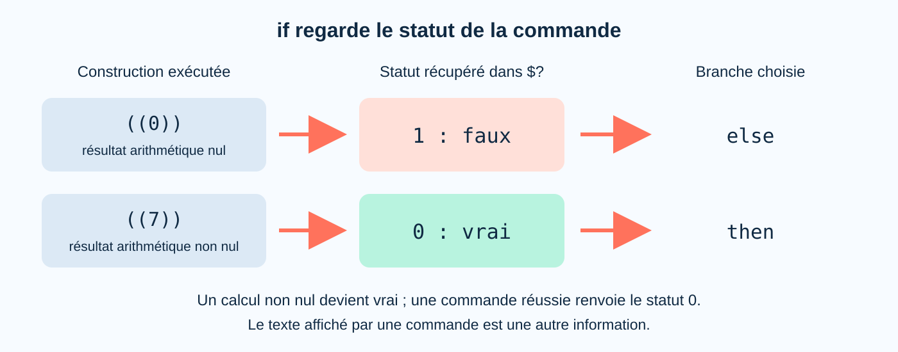

# TP 3 — Repères visuels et notions clés

Cette annexe accompagne le [TP3](../eleves/tp3-programmer-bash.md). Elle reprend les notions du cours magistral 3, *Bash avancé*, avec de courts exemples à projeter et à essayer dans Bash.

## Vue d’ensemble

```text
données → variables et arguments → calcul ou test → choix ou boucle
                                                   ↓
                                      sortie affichée et statut
```

## 1. Garder une valeur et la transmettre

```bash
secteur='Aurore Nord'
echo "${secteur}_secours"
```

- `nom=valeur` crée ou modifie une variable sans déclaration préalable. Colle le signe `=`. Le nom commence par une lettre ou `_` et peut ensuite contenir des chiffres.
- Les variables ordinaires stockent du texte. `$secteur` lit la valeur et `${secteur}` délimite le nom. Les guillemets doubles gardent les espaces dans un seul argument.
- `unset secteur` efface la variable. Dans le mode Bash habituel, une variable absente se développe en texte vide.

### Exporter vers un processus enfant

```bash
unset secteur_aurore
secteur_aurore='Aurore Nord'
bash -c 'echo "<${secteur_aurore}>"'  # <>
export secteur_aurore
bash -c 'echo "<${secteur_aurore}>"'  # <Aurore Nord>
export -n secteur_aurore
echo "<${secteur_aurore}>"          # <Aurore Nord>
```

`export` transmet la valeur aux futurs processus enfants. `export -n` arrête cette transmission et conserve la valeur dans le shell courant. Un enfant modifie sa propre copie. `export nom=valeur` affecte et exporte en une fois.

| Variable | Rôle |
|---|---|
| `USER` | Nom du compte |
| `HOME` | Dossier personnel |
| `PWD` | Dossier courant |
| `SHELL` | Shell de connexion déclaré, en général |
| `PATH` | Dossiers où chercher les exécutables |

Les noms usuels de l’environnement s’écrivent par convention en majuscules.

---

## 2. Lancer une commande et lire son statut

### Où Bash trouve le programme

| Appel | Ce qui se passe |
|---|---|
| `cd /tmp` | Bash exécute sa commande interne. |
| `./outil.sh` | Le chemin désigne le fichier à lancer. |
| `ls` | Bash cherche l’exécutable dans les dossiers de `PATH`, dans l’ordre. |

`PATH` sépare les dossiers par des `:`. `type ls` indique comment Bash résout le nom. Selon la session, un alias ou une fonction peut aussi intervenir.

```text
bash outil.sh    → Bash lit le fichier. Le droit de lecture suffit.
./outil.sh       → Le fichier doit être exécutable. Le shebang choisit l’interpréteur.
```

Avec `#!/usr/bin/env bash`, `env` retrouve Bash via `PATH`. Pour un programme externe, les fonctions `exec*` s’appuient sur `execve` pour charger le programme. Le parent récupère son statut avec un mécanisme comme `wait`.

### Le statut est une information distincte de la sortie

```bash
bash -c 'exit 7'
code=$?
echo "$code"          # 7

bash -c 'false'
echo "$?"            # 1
```

- `0` indique un succès. Un statut non nul indique un échec ou un résultat faux, selon la commande. Bash utilise les valeurs de `0` à `255`.
- `$?` contient le dernier statut. Sauvegarde-le avant une autre commande.
- `exit N` termine le script avec le statut `N`. À la fin normale d’un script sans `exit`, Bash renvoie le statut de sa dernière commande exécutée.

[Manuel Bash sur les statuts d’exécution](https://www.gnu.org/software/bash/manual/html_node/Exit-Status.html)

---

## 3. Préparer les arguments et calculer

Bash développe la ligne avant de lancer la commande. Les guillemets influencent les développements et le découpage.

```text
accolades → tilde → variables, calculs et substitutions → découpage → chemins
                    cette étape se fait de gauche à droite
```

Bash retire ensuite les guillemets syntaxiques. Avec `echo "*.log"`, l’étoile reste littérale. Avec `echo *.log`, Bash développe le motif si des noms correspondent. [Manuel Bash sur les développements](https://www.gnu.org/software/bash/manual/html_node/Shell-Expansions.html)

### Paramètres du script

| Écriture | Valeur |
|---|---|
| `$0` | Nom de lancement du script |
| `$1`, `$2`, `${10}` | Premier, deuxième et dixième arguments |
| `$#` | Nombre d’arguments hors `$0` |
| `"$*"` | Arguments réunis en un seul texte |
| `"$@"` | Arguments conservés séparément |
| `$?` | Statut de la dernière commande |

```bash
bash -c 'echo "$#"; printf "<%s>\n" "$@"' demo 'Aurore Nord' ''
```

Le script reçoit deux arguments et affiche `2`, `<Aurore Nord>` et `<>` sur trois lignes. `demo` occupe la place de `$0`.

### Calcul entier

```bash
valeur=3
echo "$((valeur * 2 + 1))"     # 7
echo "$((valeur += 1))"        # 4
echo "$valeur"                # 4
```

`$((…))` fournit la valeur calculée. À l’intérieur, les variables peuvent s’écrire sans `$`. Les parenthèses règlent les priorités. `/` donne un quotient entier et `%` le reste. `+=` modifie la variable et `++` l’incrémente.

---

## 4. Évaluer une condition



| Expression | Valeur ou statut |
|---|---|
| `echo "$((0))"` | Affiche `0`. La commande `echo` réussit. |
| `((0))` | Statut `1`, donc condition fausse. |
| `((7))` | Statut `0`, donc condition vraie. |

`if` et `while` choisissent à partir du **statut**. La construction `((…))` convertit un calcul non nul en statut de succès.

### Comparer avec `test` ou `[ … ]`

| Besoin | Exemple |
|---|---|
| Comparer deux textes | `[ "$zone" = nord ]` |
| Tester un texte non vide | `[ -n "$zone" ]` |
| Comparer des entiers | `[ "$#" -eq 1 ]` |
| Tester un fichier ordinaire | `[ -f "$chemin" ]` |
| Tester un dossier ou un droit d’exécution | `[ -d "$chemin" ]` ou `[ -x "$chemin" ]` |

Espace l’expression et les crochets. Protège les valeurs avec des guillemets. `help test` et `man test` donnent les opérateurs disponibles, dont `-ne`, `-lt`, `-le`, `-gt` et `-ge`.

---

## 5. Choisir et répéter

### `if` choisit une branche

```bash
entree=.
if [ -d "$entree" ]; then
    echo "Dossier"
elif [ -f "$entree" ]; then
    echo "Fichier"
else
    echo "Autre cas"
fi
```

Bash exécute la première branche dont le test réussit. `elif` ajoute un cas. `else` est facultatif. Le `;` sépare la condition de `then` sur une même ligne.

### `while` reteste avant chaque passage

```bash
n=3
while ((n > 0)); do
    echo "$n"
    ((n--))
done
```

La boucle affiche `3`, `2`, `1`. La mise à jour de `n` permet à la condition de devenir fausse.

### `for` parcourt une liste

```bash
for zone in nord sud 'zone est'; do
    echo "$zone"
done
```

Chaque élément donne un passage, y compris `zone est` qui forme un seul mot grâce aux guillemets. `for n in $(seq 0 2 4)` parcourt `0`, `2`, `4` dans l’ordre **début, pas, fin**. `continue` passe à l’itération suivante et `break` quitte la boucle la plus proche. Ces structures s’utilisent aussi directement dans le terminal.

---

## Diagnostic rapide

| Situation | Vérification utile |
|---|---|
| Un nom avec espaces arrive en plusieurs arguments | Vérifie les guillemets autour de la valeur et le parcours avec `"$@"`. |
| Le script fonctionne avec `bash` et échoue avec `./` | Vérifie le droit d’exécution et le shebang. |
| `$?` indique le résultat d’une autre commande | Capture le statut juste après l’appel voulu. |
| La boucle continue indéfiniment | Repère ce qui fait évoluer la condition. |
